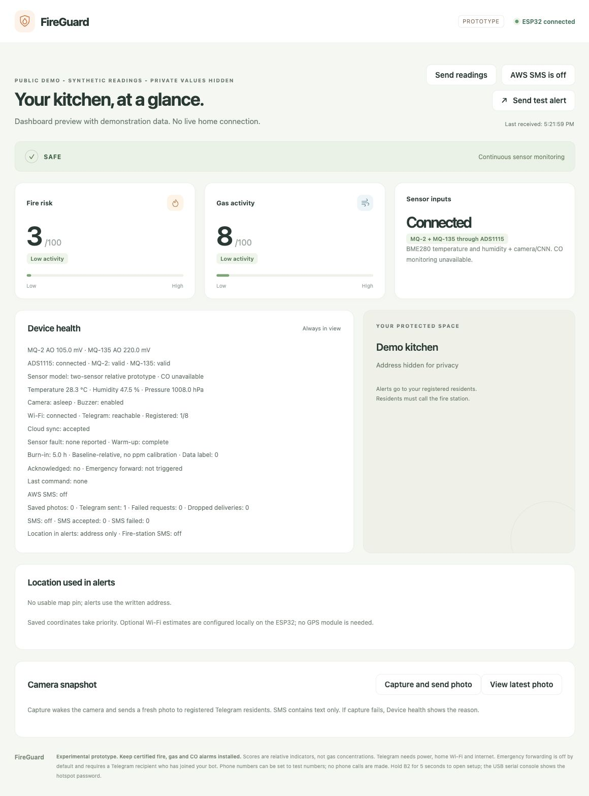
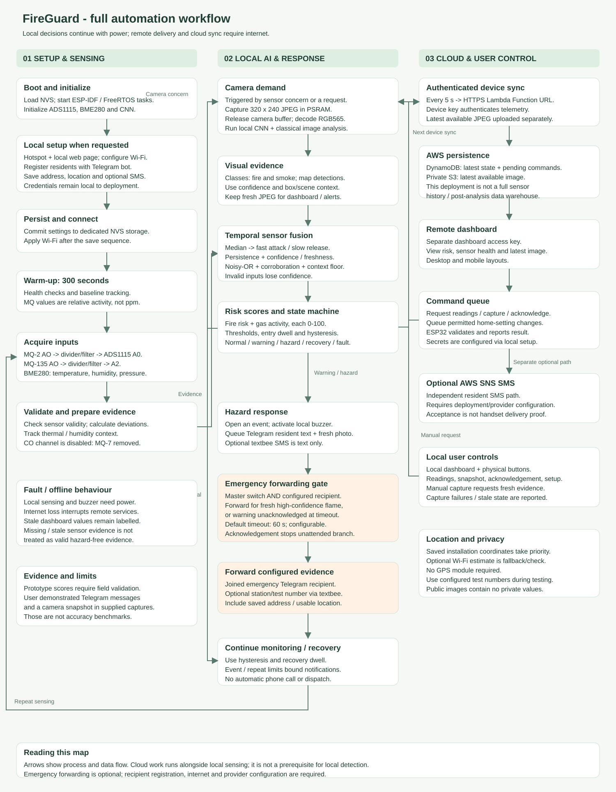
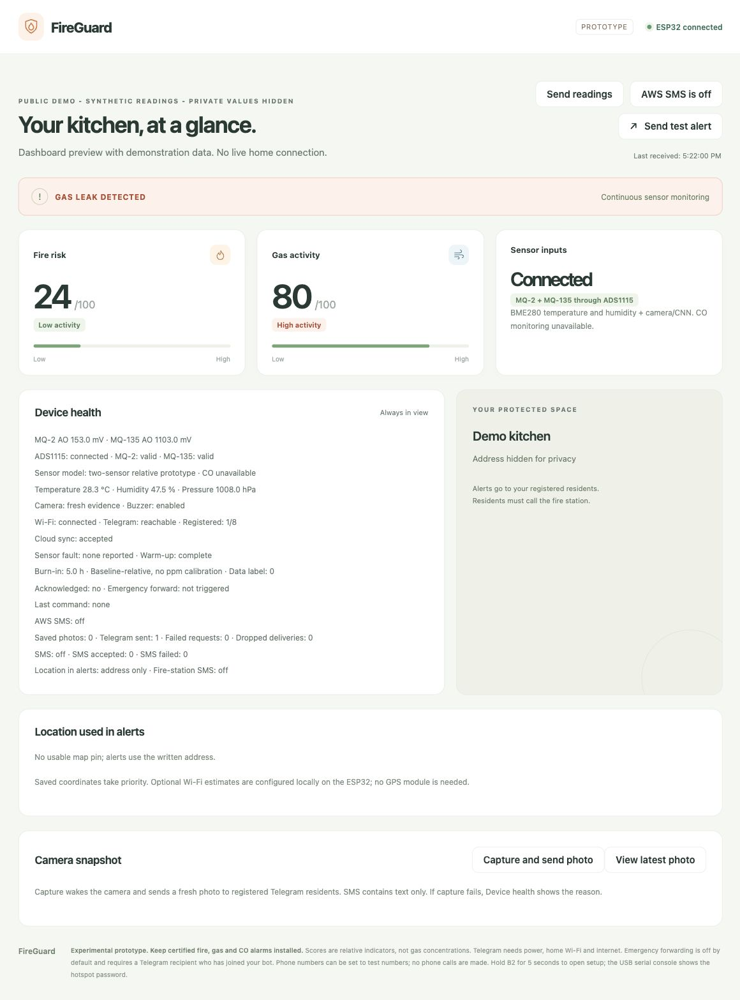
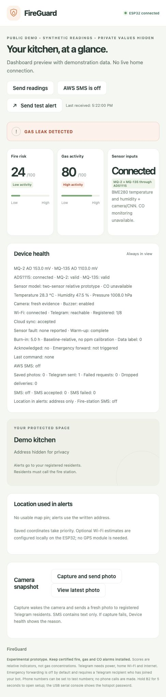
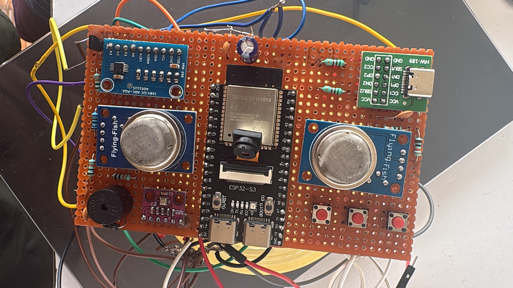
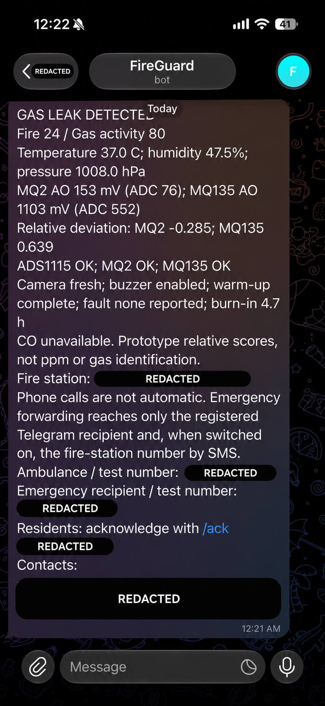
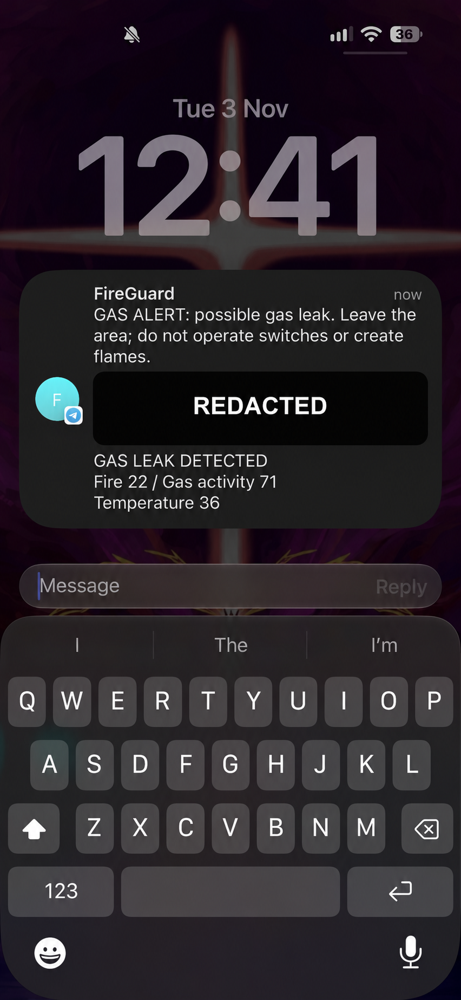
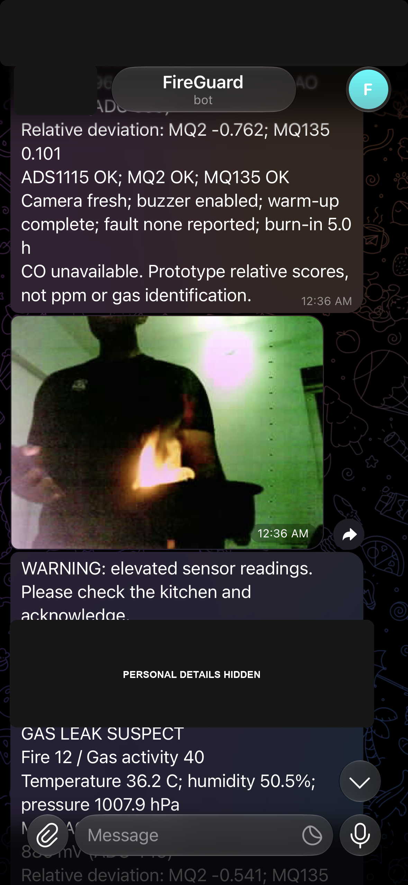

# FireGuard

An ESP32-S3 fire and gas activity monitoring prototype with local CNN inference, sensor fusion, Telegram alerts and an AWS dashboard.

**Hardware:** ESP32-S3 N16R8 CAM / OV5640, MQ-2, MQ-135, ADS1115, BME280 and a transistor-driven buzzer. **Firmware:** ESP-IDF + FreeRTOS. **Cloud:** AWS Lambda, DynamoDB and private S3. MQ-7, OLED and microSD are not part of this revision.



## How it works

1. Sample MQ-2/MQ-135 through protected ADC inputs and read BME280 environmental data.
2. Compare relative gas activity with a baseline; evaluate thermal trends, validity and persistence.
3. Wake the camera on concern or explicit request. Run the local fire/smoke CNN with classical image context.
4. Fuse evidence into fire/gas scores and a state machine with dwell and hysteresis.
5. Activate the buzzer and queue resident alerts. Optionally forward an unattended warning or high-confidence flame event to a configured emergency recipient.
6. Sync device status to AWS; display the latest image and accept acknowledged remote commands.

## Full automation map



[Open the detailed workflow and editable Mermaid flow](docs/AUTOMATION_WORKFLOW.md).

## Screenshots and hardware

Dashboard views below use **synthetic demo data**, not private live household telemetry. The hardware photograph is the original rotated exactly 90 degrees clockwise, with metadata removed.

| Desktop alert state (demo) | Mobile dashboard (demo) |
| --- | --- |
|  |  |

### Assembled hardware



## Redacted Telegram alerts

Three examples from the supplied project captures: the detailed alert, a phone notification, and the camera snapshot delivered in Telegram. Personal names, addresses, landmarks, phone numbers and account/event identifiers are hidden. The **camera photograph, including the person, is unchanged**, as requested.

| Detailed Telegram alert | Phone notification | Camera snapshot message |
| --- | --- | --- |
|  |  |  |

The detailed alert and phone-notification examples are **AI-edited privacy-redacted illustrations**; they are not unaltered captures. The snapshot example uses opaque text masks and preserves the original camera-photo pixels. See [image preparation notes](docs/images/README.md). These examples illustrate delivery and interface behaviour, not detection-accuracy benchmarks.

## Documentation

- [Three-page automated system report](docs/FireGuard-Automated-System-Report.pdf)
- [Current circuit diagram (PDF)](docs/FireGuard-updated-circuit.pdf) and [PNG](docs/FireGuard-updated-circuit.png)
- [Pin connections and components](docs/CIRCUIT.md)
- [Build and test guide](docs/FireGuard-build-and-test-guide.pdf)
- [Firmware build and flashing](firmware/README.md)
- [AWS deployment](cloud/README.md)
- [Telegram/SMS configuration](docs/SMS_SETUP.md), [AWS SMS](docs/AWS_SMS_SETUP.md) and [location](docs/LOCATION_SETUP.md)
- [CNN training workflow](training/README.md)
- [Validation records](docs/VALIDATION.md) and [privacy notes](docs/PUBLICATION_PRIVACY.md)

## Project layout

```text
firmware/    ESP-IDF firmware, web UI, sensor fusion and embedded CNN model
cloud/       Lambda application, generated dashboard and deployment template
training/    Dataset preparation, distillation, pruning and quantization scripts
tests/       Portable firmware and dashboard regression tests
docs/        Circuit, report, workflow map and sanitized images
release/     Build provenance; private-path-bearing prebuilt binaries omitted
```

## Build

Use an ESP-IDF environment compatible with the project (the recorded build used the IDF 6.x toolchain). From the project root:

```sh
cd firmware
idf.py set-target esp32s3
idf.py build
idf.py -p YOUR_SERIAL_PORT flash monitor
```

See the firmware guide for the 16 MB flash / 8 MB octal PSRAM configuration, dependency versions and safe power connections. The embedded `.espdl` model is included. Prebuilt binaries are excluded from this public repository because their compiler diagnostics embed private local paths; the original private final package is unchanged.

## Validation and scope

The release is `3.7-snapshot` / hardware `two-mq-ads1115-v2`. Recorded checks cover portable logic, cloud routes, startup, sensor readout and camera-to-AWS image retrieval. Supplied user captures also show Telegram text and an image arriving. The retained CNN was not independently benchmarked on a real fire dataset during this integration. This repository does not claim measured real-world accuracy, certified protection, selective gas identification, ppm or CO readings. Keep certified alarms installed.

## Privacy

No home address, phone number, bot token, API key, live AWS endpoint/resource ID, private logs or original personal screenshots are included. Git commits use a GitHub no-reply address. Each user configures their own deployment and recipients locally. Demo screenshots contain invented readings and hidden address text. Optional SMS services require separate credentials/configuration and may incur provider charges.
